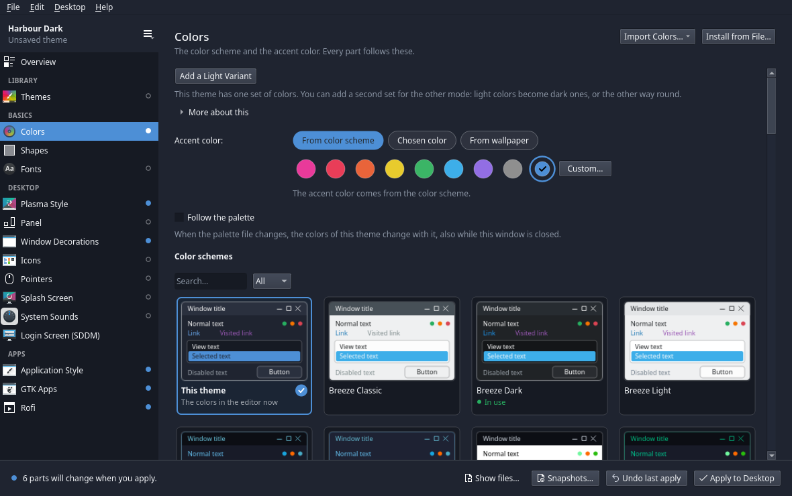

<p align="center">
  
</p>

# Plasma Theme Studio

One app for editing an entire KDE Plasma theme in one place.

Set colors, corner radii, borders, shadows, opacity and the panel's position in one theme. Plasma Theme Studio writes the files each part of the desktop needs and reloads the desktop live.

> **Status: early development (v0.1).** The window has a page for every part of System Settings' Colors & Themes (Global Themes, Colors, Application Style, Plasma Style, Window Decorations, Icons, Pointers, Splash Screen, System Sounds, Fonts), the panel, GTK applications and Rofi, each with preview cards and a live preview. Colors, the window frame, the panel and the other parts can be edited, previewed, applied and undone; theme colors can be taken from the wallpaper or imported from pywal, matugen and `.colors` files. The login screen is only linked to System Settings. What works and what does not is in [docs/STATUS.md](docs/STATUS.md); the plan is in [docs/PRD.md](docs/PRD.md).



## Try it

You need KDE Plasma 6, Python 3.11 or newer, and your distribution's PySide6 and Jinja2 packages.

| Distribution | Install the dependencies |
|---|---|
| Arch, CachyOS, Manjaro | `sudo pacman -S --needed pyside6 python-jinja` |
| Fedora | `sudo dnf install python3-pyside6 python3-jinja2` |
| Debian, Ubuntu | `sudo apt install python3-pyside6.qtwidgets python3-jinja2` |
| openSUSE | `sudo zypper install python3-pyside6 python3-Jinja2` |

Run it from a checkout, without installing anything:

```sh
git clone https://github.com/Kryckan/plasma-theme-studio.git
cd plasma-theme-studio
./plasma-theme-studio
```

On Arch-based systems you can build a package instead:

```sh
cd packaging/arch
makepkg -si
```

Use the distribution's PySide6, not the one from pip. Only the distribution's build loads the KDE widget styles.

## Features

- A page for every part of System Settings' Colors & Themes, and for the panel, GTK applications and Rofi, with preview cards and a live preview.
- Colors from a scheme, a chosen accent, the wallpaper, any picture, or an import (pywal, matugen, `.colors`); a contrast check that fixes hard-to-read text.
- Light and dark variants: *Add a Dark Variant* on the Colors page makes the second set from the first; `apply FILE --variant light|dark` picks one.
- Window frames, panel position and style, fonts, title bar buttons, pointers, sounds and splash screen, each with *Leave as it is* | *Set by this theme*.
- Overview of what an apply does to every part, *Show files…*, snapshots and *Undo last apply*.

## Safety

- The app writes only inside your home folder and never asks for root.
- *Show files…* lists every file before you apply.
- It also lists the desktop settings an apply changes. The window frame, the panel style and the panel position are only touched when the theme asks for them, except that a window frame made by this app is recolored when a theme or color scheme with other colors is put on the desktop.
- A snapshot is taken before every apply. **Undo last apply** puts the files and settings back, one apply at a time. Restoring an older snapshot undoes every apply made after it as well.
- If the desktop becomes hard to use, switch to a text console (Ctrl+Alt+F3), log in and run:

  ```sh
  plasma-theme-studio restore
  ```

Themes are stored in `~/.local/share/plasma-theme-studio/themes/` and snapshots in `~/.local/share/plasma-theme-studio/snapshots/`.

## Command line

```
plasma-theme-studio [FILE]           open the editor
plasma-theme-studio validate FILE    check a theme file
plasma-theme-studio apply FILE       apply a theme file to the desktop
plasma-theme-studio apply FILE --variant light|dark   apply one variant of a theme that has both
plasma-theme-studio status FILE      show what the desktop has now and what the theme would change
plasma-theme-studio restore          undo the latest apply (repeat to go further back)
plasma-theme-studio restore ID       go back to a chosen snapshot, undoing the applies after it
plasma-theme-studio restore --list   list the snapshots
plasma-theme-studio export FILE ARCHIVE         pack a theme as a .ptstheme archive
plasma-theme-studio import ARCHIVE              save an archive's theme in the library
plasma-theme-studio export-global-theme FILE FOLDER   write a Global Theme with install.sh
```

## Why

Customizing Plasma today means working in several unrelated places and file formats: color schemes, the application style, the window decoration, hand-edited SVG files for the panel, and CSS for GTK apps. A single decision such as "8 px corners everywhere" has to be made five times.

Plasma Theme Studio does not replace those systems. It drives them from a single theme file.

```
my-theme.toml ──► generators (one per target) ──► files in your home directory ──► live reload
```

## Planned features

- Draw mode inside the frame editor (today the editor opens the frame in Inkscape)
- Klassy as a window decoration

## Targets

| Part of the desktop | Backend | State |
|---|---|---|
| Colors | Plasma color scheme | Works |
| Window decoration | Generated frame (exact radius, border and shadow); Breeze (its fixed steps) | Works |
| Panel background | Plasma style (SVG) | Works |
| Panel position | Plasma's scripting interface | Works for up to six panels |
| App widgets | Kvantum (generated theme) | Works in tests and the rig |
| Popups, tooltips, widgets | Plasma style (SVG) | Works in tests |
| GTK 3 / GTK 4 apps | CSS overrides | Works in tests |
| Rofi | Rofi theme | Works in tests |
| Plasma style, application style, window decoration, icons, pointers, fonts, splash screen, sounds, title bar buttons | The installed ones, set through the desktop's own settings files | Works in tests |
| Login screen (SDDM) | Not edited (needs administrator rights); the app opens System Settings | Link only |

The window frame, panel style and panel position have so far been tried with Plasma 6.8 in an isolated test session only.

## Platform support

- **Plasma 6.6 or newer:** all targets.
- **Plasma 6.3 to 6.5:** everything except the optional Klassy window decoration.
- **Plasma 5:** not supported.

The first packages target Arch Linux (AUR). Packages for Fedora, openSUSE, Debian and Ubuntu are planned for 1.0. Details are in the [PRD](docs/PRD.md#11-platform-support).

## Roadmap

| Milestone | Scope |
|---|---|
| v0.1 | Theme file, colors, window frame, panel look and position, apply, undo, translations, first Arch package |
| v0.2 | Shapes for app widgets, real-style preview, pywal and matugen import |
| v0.3 | Frame editor with Open in Inkscape, popups and widgets (in 0.1), draw mode |
| v1.0 | GTK, Rofi, export and import and the command line (in 0.1), packages for more distributions |

## Design

- [Product requirements](docs/PRD.md)
- [Project status](docs/STATUS.md)
- [Changelog](CHANGELOG.md)
- [Interactive UI mockup](docs/mockup.html) (download and open in a browser)

## Technology

Python with PySide6 (Qt 6 Widgets), Jinja2 templates, and Qt Linguist for translations. The UI follows the system language; English and Swedish are included.

## Developer tools

`scripts/rig_roundtrip.py` applies a theme inside a throwaway desktop (the rig), undoes it, and compares the rig's home before and after. Start a rig, run the script through the memory cap, then stop the rig:

```sh
/usr/bin/python3 scripts/desktop_rig.py start /tmp/pts-rig-x --plasmashell
scripts/capped /usr/bin/python3 scripts/rig_roundtrip.py /tmp/pts-rig-x --list
scripts/capped /usr/bin/python3 scripts/rig_roundtrip.py /tmp/pts-rig-x
/usr/bin/python3 scripts/desktop_rig.py stop /tmp/pts-rig-x
```

It never touches your real session.

## Contributing

See [CONTRIBUTING.md](CONTRIBUTING.md) for how to run the tests and add a translation.

## License

GPL-3.0-or-later. See [LICENSE](LICENSE).
