# Plasma Theme Studio: user guide

This guide is for a person who has never made a desktop theme. You do not need to know what a config file is. Every part of the desktop that this app can change is explained in plain words, and every change can be taken back.

The pictures in this guide are made by `scripts/make_screenshots.py`, from a sample theme.

- [What the app is](#what-the-app-is)
- [Your first theme in five minutes](#your-first-theme-in-five-minutes)
- [The window](#the-window)
- [The pages, one by one](#the-pages-one-by-one)
- [Light and dark versions of a theme](#light-and-dark-versions-of-a-theme)
- [Your own frames with Inkscape](#your-own-frames-with-inkscape)
- [Colors from a wallpaper or a picture](#colors-from-a-wallpaper-or-a-picture)
- [Follow the palette](#follow-the-palette)
- [Export, import and sharing](#export-import-and-sharing)
- [The command line](#the-command-line)
- [Where files are written, and how to get everything back](#where-files-are-written-and-how-to-get-everything-back)
- [Questions and answers](#questions-and-answers)

## What the app is

The look of a KDE Plasma desktop is made of many parts: the colors, the frame around windows, the panel, the look of buttons in applications, the icons, the mouse pointer, the fonts and more. In System Settings each part has its own page, and some parts (for example the panel's frame) can only be changed by editing files by hand.

Plasma Theme Studio puts all of it in one window. You keep one **theme**: a small text file that says "these colors, corners this round, this frame, this panel". The app writes everything the desktop needs from that file, tells the desktop to look again, and keeps a copy of what was there before, so that **Undo last apply** puts the old look back exactly.

Three ideas are enough to use it.

- **A theme** is what you edit. It lives in the editor until you apply it.
- **Apply to Desktop** puts the theme on your desktop. Nothing reaches the desktop before you choose it.
- **Undo last apply** takes the latest apply back, file by file.

Every part of the desktop has a switch, **Leave as it is | Set by this theme**. A part that is left as it is stays exactly as your desktop has it now. That is why a theme can be small: it only has to name the parts you care about.

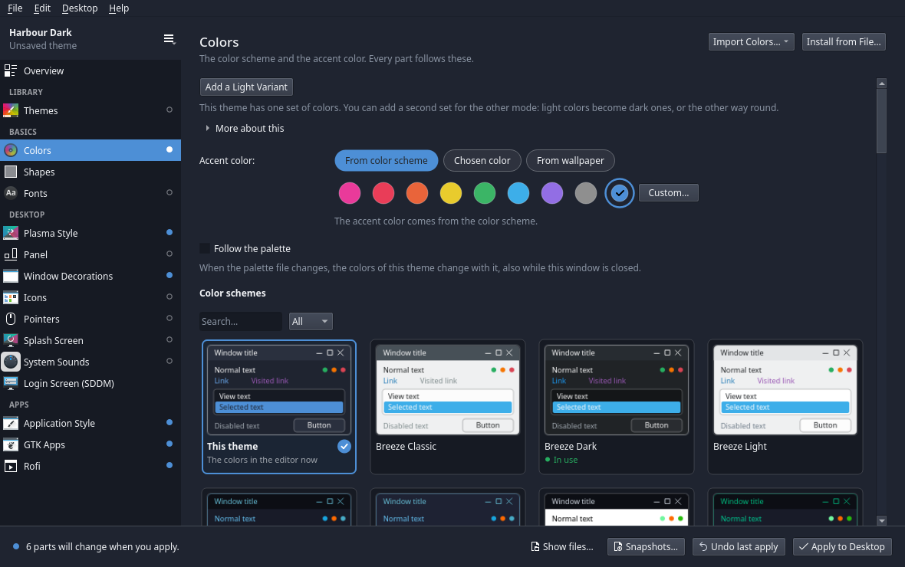

## Your first theme in five minutes

1. **Start the app.** Open it from the application menu (Plasma Theme Studio), or run `plasma-theme-studio` in a terminal.
2. **Start from what you have.** Choose **Themes** in the side bar, then **New Theme from the Desktop**. The editor now holds a theme with the colors and parts your desktop uses at this moment. Nothing has changed on the desktop.
3. **Change the accent.** Choose **Colors**. Under **Accent color** click one of the round colors, or **Custom…** for your own. The cards below and the preview on the other pages change at once.
4. **Look at what will happen.** Choose **Overview**. Every part has a row that says **Will change**, **Already so** or **Left as it is**. You can also choose **Show files…** at the bottom to see every file that will be written. Nothing is written yet.
5. **Apply.** Choose **Apply to Desktop** at the bottom right. Windows, the panel and applications change within a second or two.
6. **Do not like it? Undo.** Choose **Undo last apply** (also in the **Desktop** menu). The desktop is back as it was before step 5.

When you like the result, save it with **File > Save** so that you have the theme as a file of your own. A theme you save appears under **My themes** on the Themes page.

## The window

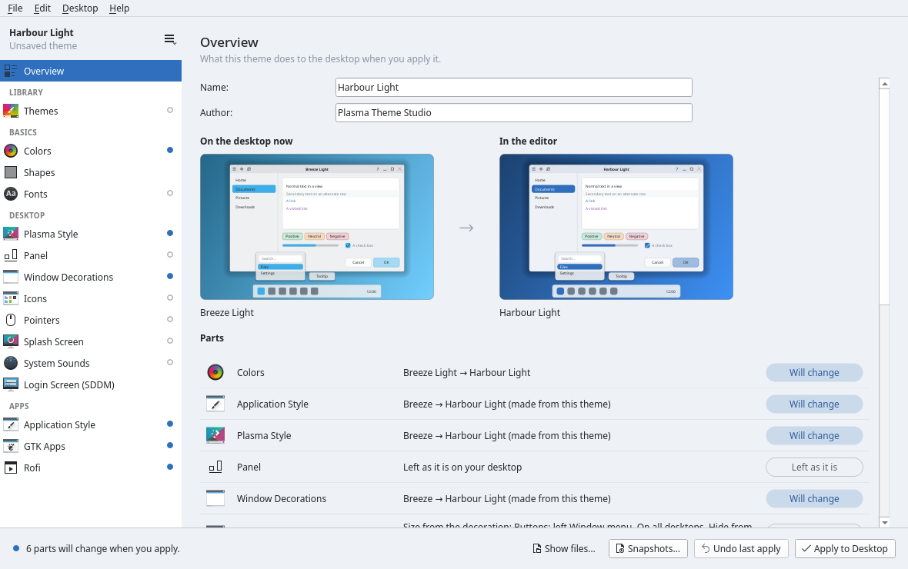

- **The side bar** on the left has a page for every part of the desktop, in four groups: Library, Basics, Desktop and Apps. A filled dot beside a page means "applying would change this part". A small empty ring means the theme leaves that part as it is.
- **The page** in the middle is where you edit. Most pages have **Leave as it is | Set by this theme** at the top, cards you can click, and values below.
- **The bar at the bottom** says in a sentence what an apply would do, and holds the four buttons: **Show files…**, **Snapshots…**, **Undo last apply** and **Apply to Desktop**.
- **The theme block** at the top left names the theme, says if it has unsaved changes, and has the menu for opening, saving, importing and exporting.

Choosing a page or a card never changes the desktop. Only **Apply to Desktop** does.

Some notes carry a small triangle and the words **More about this**. They hide the technical detail so that the page stays short. Open one if you want to know how a part works.

## The pages, one by one

### Overview

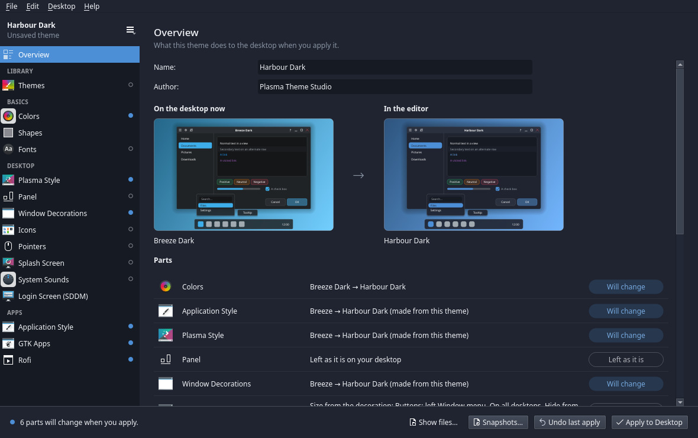

Shows the desktop as it is now next to the theme in the editor, then one row for each part: what it is now, what the theme would make of it, and a label. **Left as it is on your desktop** means the theme does not name this part. You also set the theme's name and author here, and see the last three applies.

### Themes

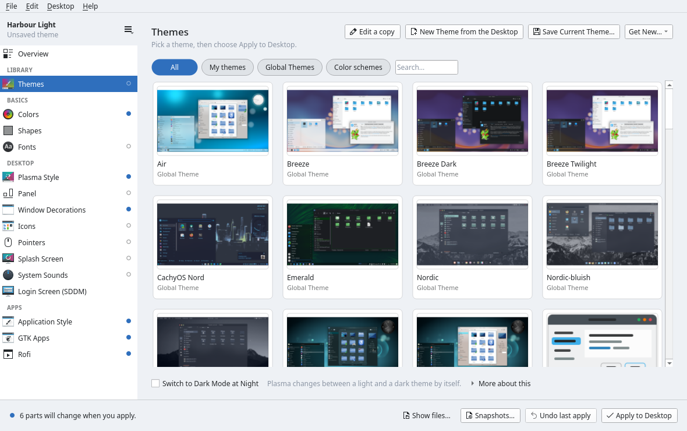

Everything you can switch to: your saved themes (**My themes**), the Global Themes installed on the computer, and the color schemes. Click a card to select it, then choose **Apply to Desktop**. A Global Theme or color scheme is first loaded into the editor, so you can change it before you apply.

- The button at the top, **Load into the editor** (Global Theme), **Edit** (a saved theme) or **Edit a copy** (a color scheme), loads the selected card into the editor. A color scheme becomes a new theme that you can change without touching the scheme.
- **New Theme from the Desktop** starts from what your desktop uses now.
- **Save Current Theme…** saves the editor's theme as a file.
- **Get New…** has **Install from File…** and **Find More in System Settings…**, where new themes can be downloaded.
- **Switch to Dark Mode at Night** lets Plasma change between a light and a dark Global Theme by itself, the two that you choose.

### Colors

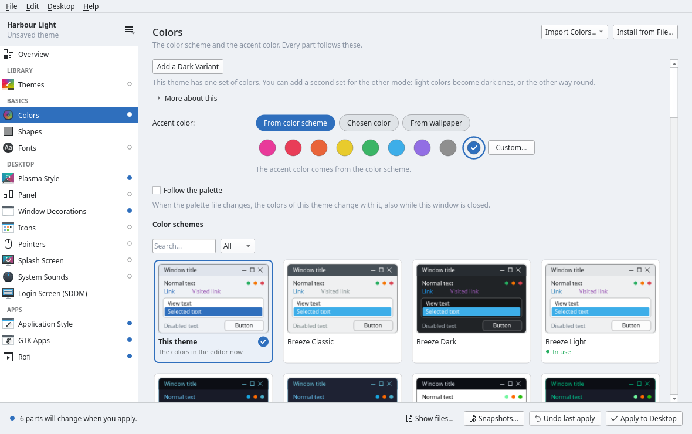


The color scheme and the accent color. Every other part follows these.

- **Accent color**: the eight standard colors of System Settings, the accent the theme has, or **Custom…**. **From wallpaper** lets Plasma take the accent from your wallpaper and keep following it.
- **Color schemes**: cards drawn as small windows. Click one to take its colors as the start for your theme. The card **This theme** shows what the editor holds. **All / Light / Dark** filters the list.
- **Import Colors…**: colors from pywal, matugen or a `.colors` file, or from a picture (see below).
- **Install from File…**: puts a color scheme file into your own color schemes.
- Lower down, the twelve colors one by one, and a box that checks that text is easy to read. **Fix Contrast…** shows each color as it is and as it would become, and changes nothing until you agree.

### Shapes

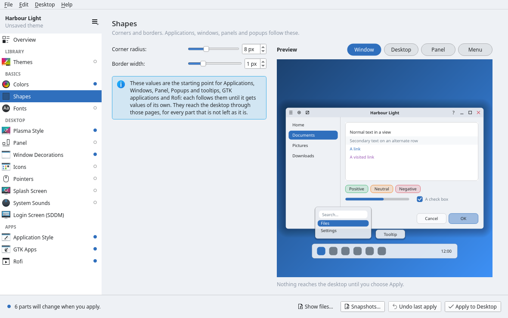

Two numbers, **Corner radius** and **Border width**. Windows, the panel, popups, application widgets, GTK applications and Rofi all start from them, so "8 px corners everywhere" is one setting. A part can have a value of its own (for example a rounder panel); it says **Same as Shapes** until you uncheck that.

The preview has four views: **Window**, **Desktop**, **Panel** and **Menu**.

### Fonts

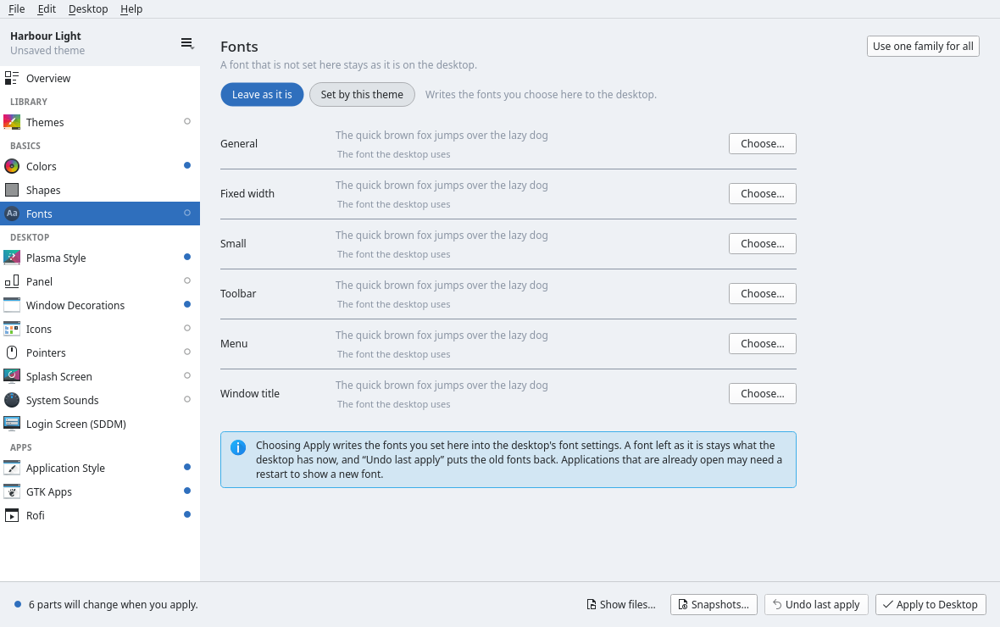

Six fonts: General, Fixed width, Small, Toolbar, Menu and Window title. Choose **Set by this theme**, then **Choose…** on a row. **Use one family for all** sets one family everywhere and keeps the sizes. A font that is not set here stays as it is.

### Plasma Style

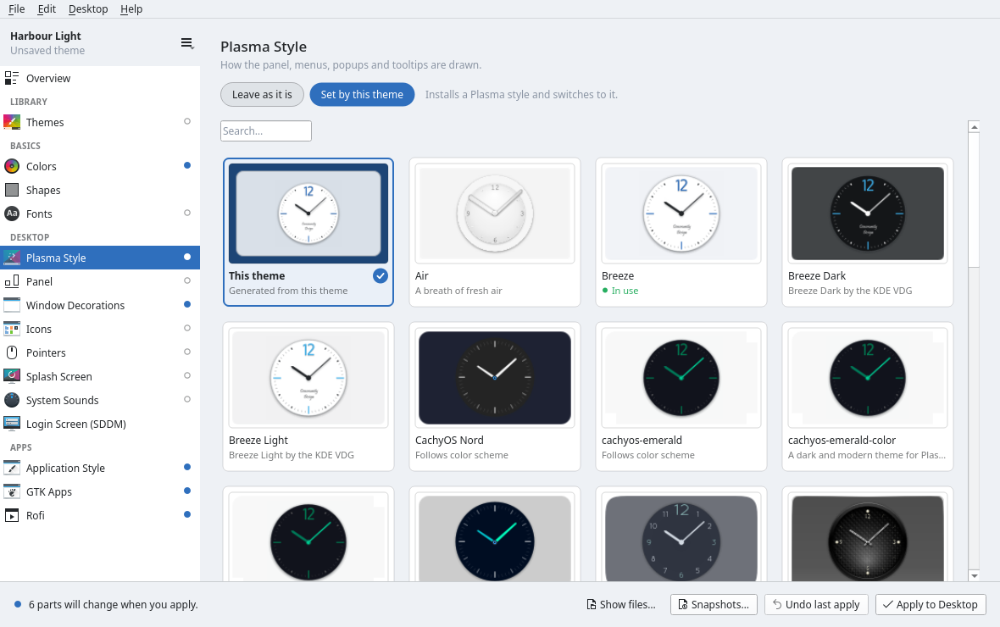

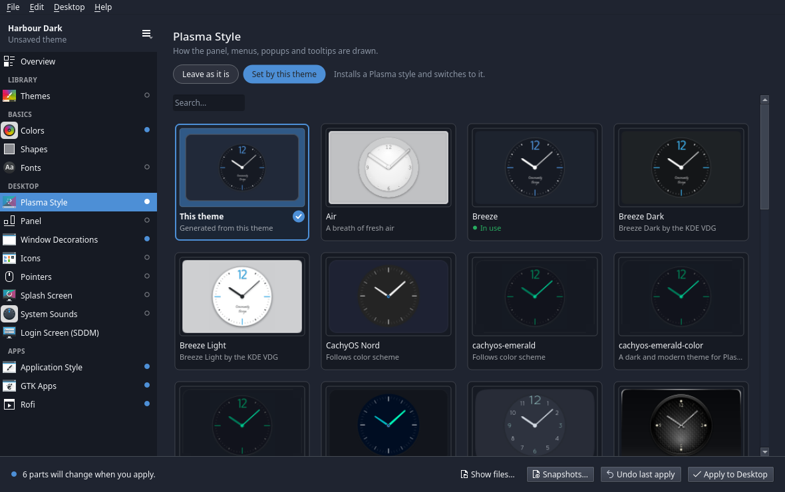

How the panel, menus, popups and tooltips are drawn. Pick an installed style, or **This theme**, which makes a style from your colors and shapes. Lower on the page, **Panel**, **Popups and tooltips** and the frames let you change the opacity, the corners and the border of each, and draw your own frame (see below).

### Panel

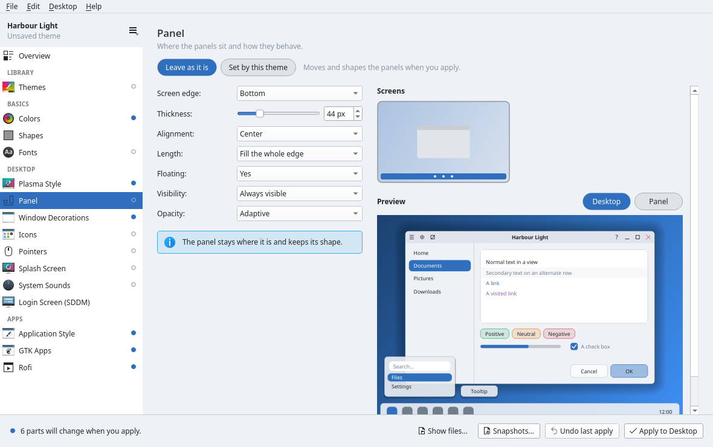

Where the panel sits and how it behaves: screen edge, thickness, alignment, length, floating, visibility and opacity. Up to six panels can be set, one after the other, with a chooser for each. A value that you do not set stays as it is. The preview shows the whole screen edge.

### Window Decorations

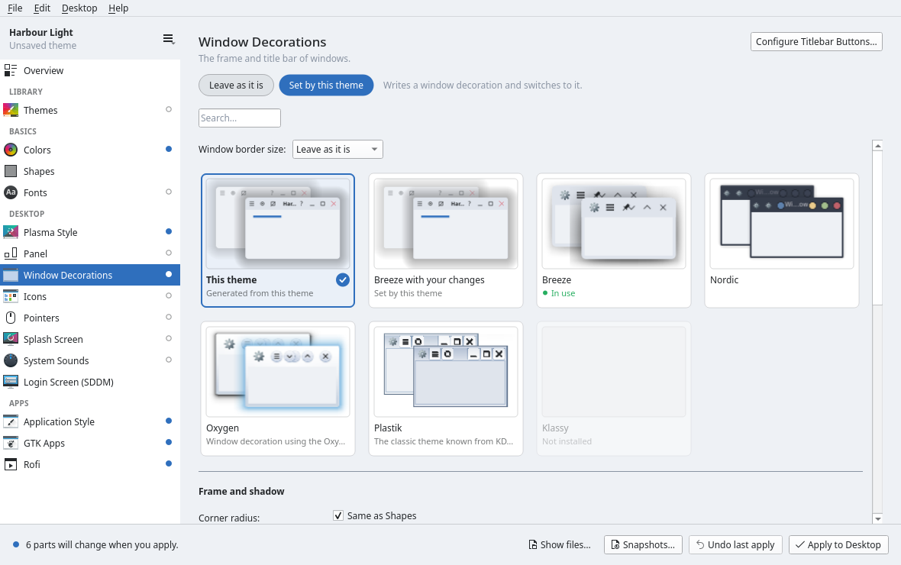

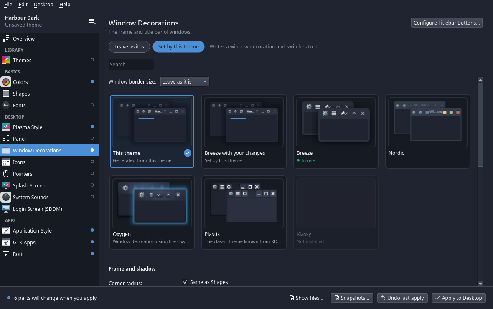

The frame and title bar of windows. **This theme** draws a frame with exactly your corner radius, border and shadow, in your colors. **Breeze** is the standard frame, which only has fixed steps. Further down, the title bar height, the size and spacing of the buttons, and the shadow. **Configure Titlebar Buttons…** lets you drag buttons between the left, the right and a pool of unused ones.

### Icons, Pointers, Splash Screen, System Sounds

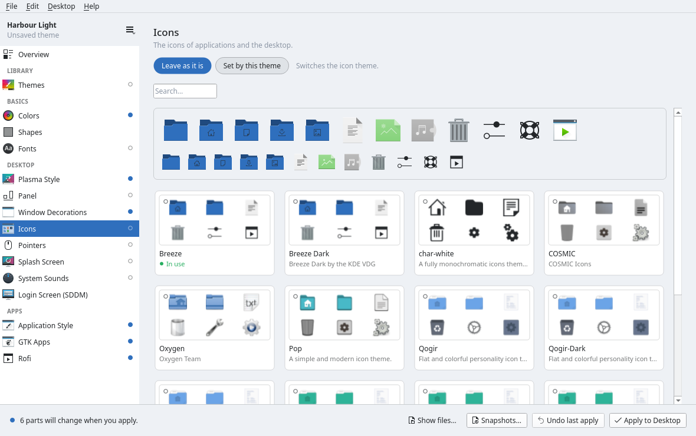

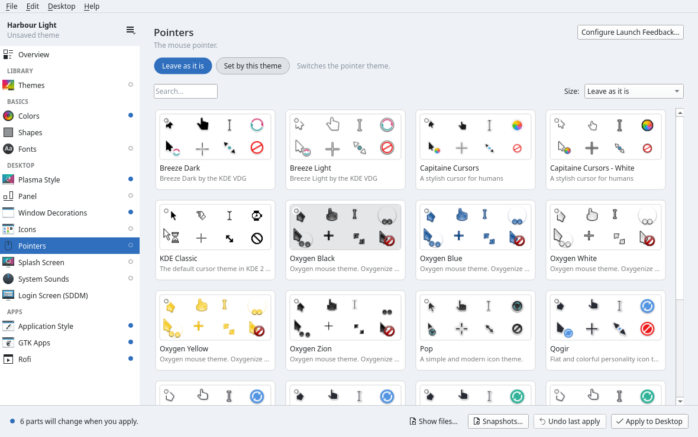

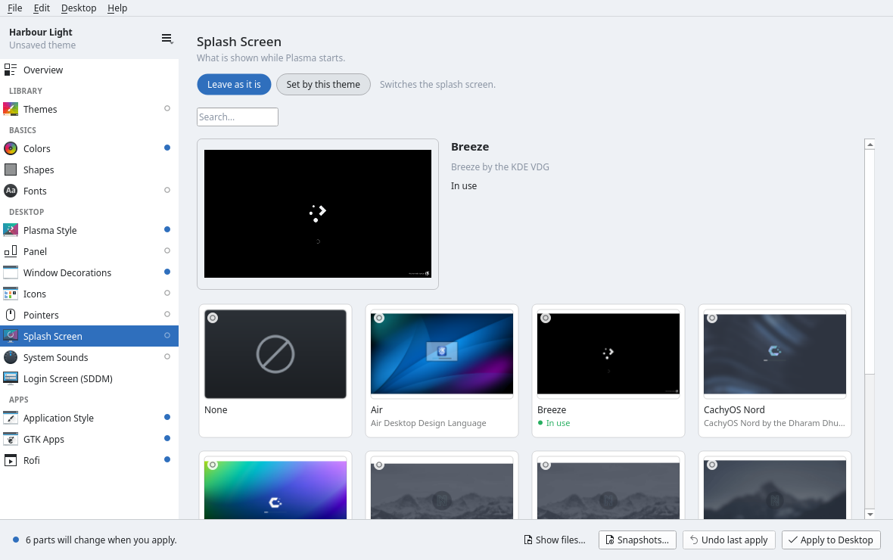

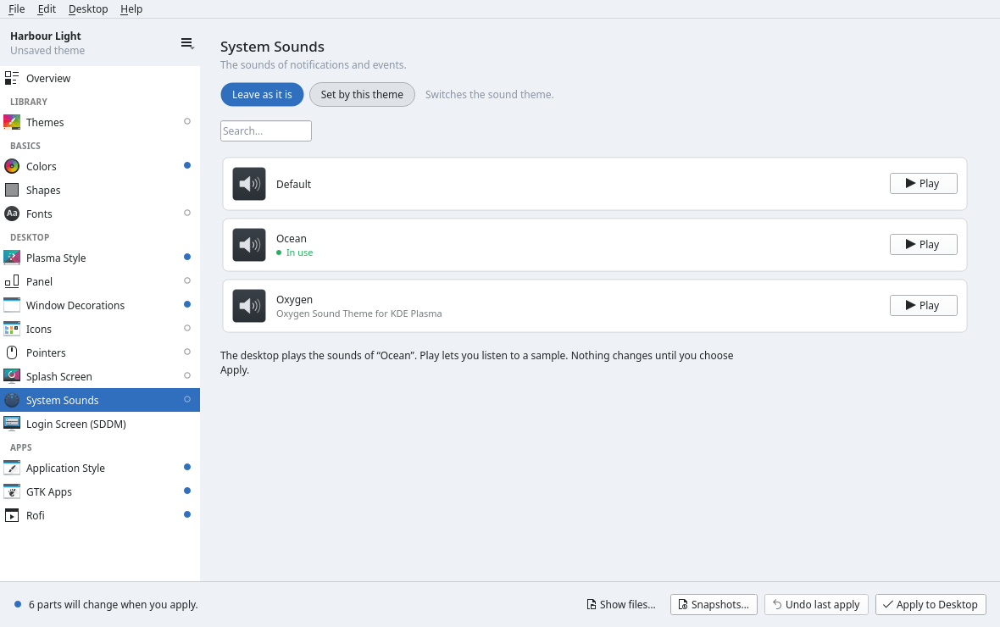

These four parts have no values of their own: you choose one of the installed ones. **Icons** shows six sample icons on each card. **Pointers** shows eight sample pointers and has **Size:** and **Configure Launch Feedback…**. **Splash Screen** shows a large preview of what is shown while Plasma starts. **System Sounds** lists sound themes; **Play** lets you listen before you choose.

### Login Screen (SDDM)

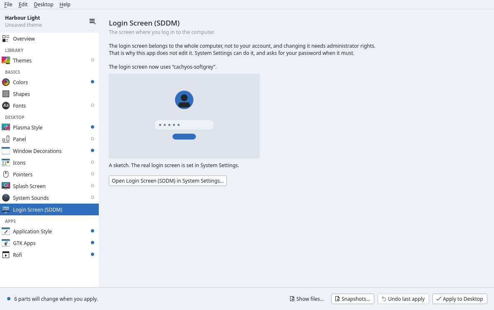

The login screen belongs to the whole computer and changing it needs the administrator's password, so the app does not edit it. The page shows which one is used and has a button that opens the right page of System Settings. If the login screen theme ships no picture, the page draws a sketch in your theme's colors and says so.

### Application Style

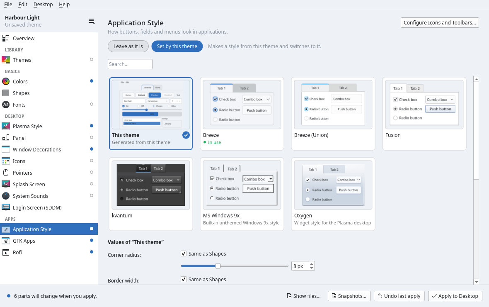

How buttons, fields, menus and tabs look in applications. **This theme** makes a style with the program **Kvantum** from your colors and shapes. If Kvantum is not installed the page says that **This theme** needs a small helper program (**More about this** names it), and the other styles still work. The values are limited to what looks right: controls never get a corner rounder than 8 px.

### GTK Apps

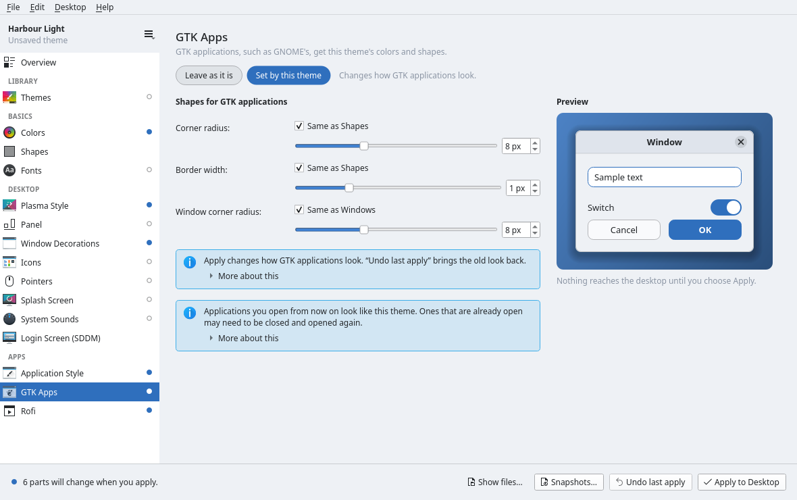

GTK applications (such as the ones made for GNOME) do not look at the Plasma color scheme in the same way. With **Set by this theme** the app writes a style sheet for GTK 3 and one for GTK 4 with your colors, corners and borders. Applications you open after the apply look like the theme; open ones may need to be closed and opened again.

### Rofi

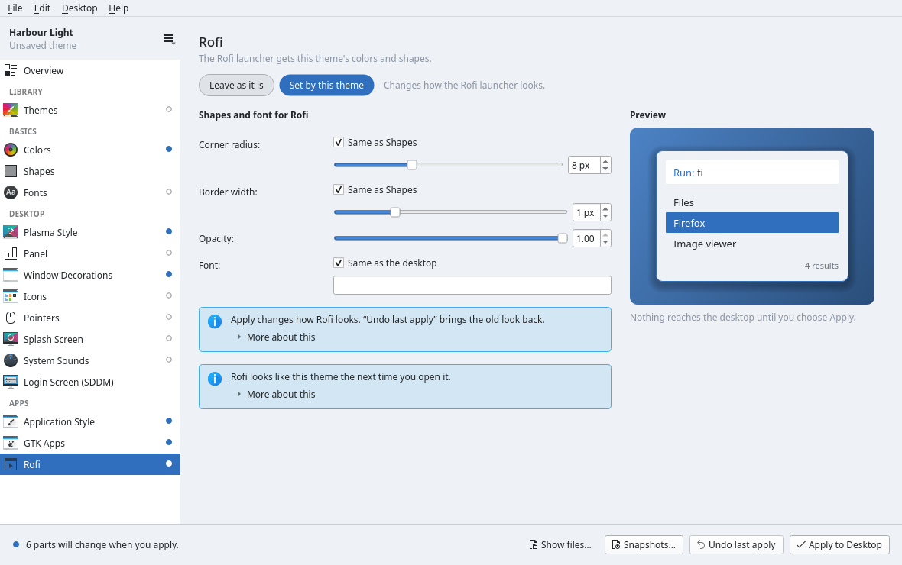

Rofi is a launcher for the keyboard. If you use it, **Set by this theme** writes a Rofi theme with your colors and shapes and selects it. The app checks the theme with Rofi itself before it writes it. Your own Rofi settings are kept; only the line that picks the theme changes.

## Light and dark versions of a theme

A theme can have two sets of colors, one light and one dark. Shapes, fonts and everything else are the same in both.

1. On **Colors**, choose **Add a Dark Variant** (or **Add a Light Variant** for a dark theme). The second set is made from the first: the hues stay, the lightness is turned around, and the text colors are corrected so that they stay easy to read.
2. Two buttons, **Light** and **Dark**, now appear. The one you choose is the set you edit and the set **Apply to Desktop** puts on the desktop.
3. Change any color of the second set afterwards, as you like.

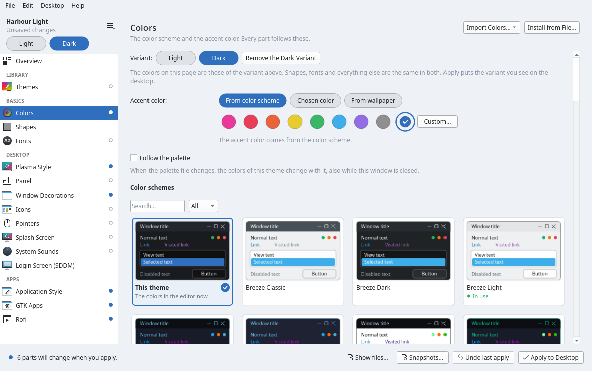

On the command line, `apply FILE --variant dark` picks one.

## Your own frames with Inkscape

Plasma draws the panel, popups, tooltips and widget backgrounds from picture files. The app makes them from your values, but you can draw them yourself.

1. Choose **Plasma Style** and scroll to **Frames**.
2. Click the frame you want (**Panel**, **Popups**, **Tooltips** or **Widget backgrounds**), then **Open in Inkscape…**. Inkscape must be installed.
3. Draw, save the file and close Inkscape. The card now shows your picture and says so.
4. Tick **Show how the frame is cut into nine parts** to see the guide lines. The four corners are kept as they are, the sides stretch.
5. **Back to the generated frame** drops your picture and goes back to the one made from the values.

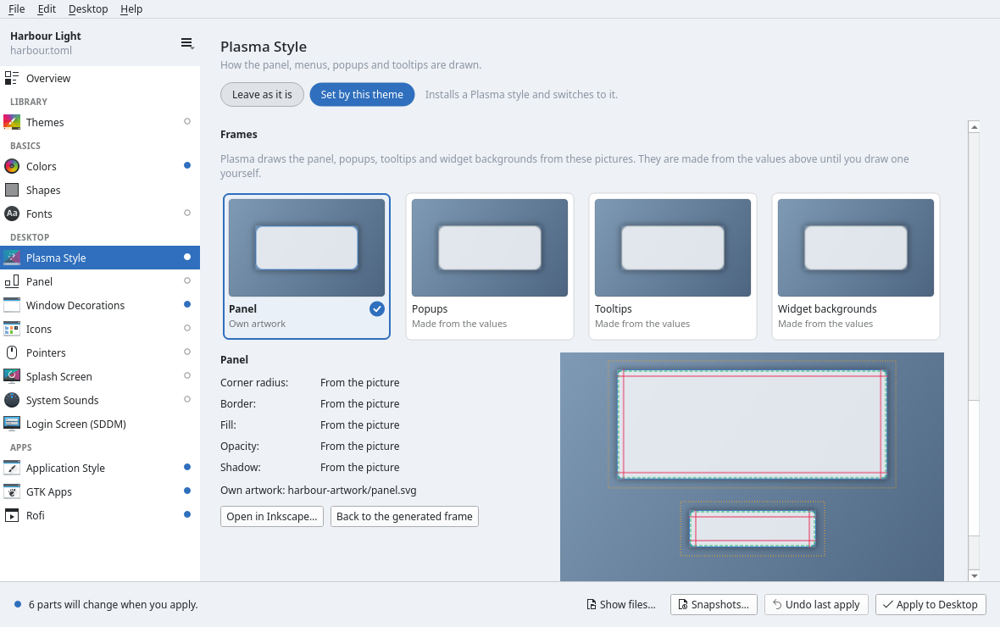

Your pictures are kept next to the theme file, in a folder with the name of the file and `-artwork` at the end, and travel with the theme when you export it. A picture that takes too long to draw, or that cannot be drawn, is not trusted: the app draws it in a separate process with a time limit and shows the generated frame with a message instead. **Apply to Desktop** leaves such a picture out too, and says so; after a few minutes the app tries a picture that only took too long again.

## Colors from a wallpaper or a picture

- **From the wallpaper:** on **Colors**, open the **Colors from the wallpaper** section. It is closed at first and sits below the color schemes. The app reads your wallpaper and offers the colors it finds. Pick one as the accent in the **From the wallpaper:** row at the top, or choose **Use as light theme** or **Use as dark theme** to fill in the colors of the whole theme. A window shows the result before anything changes.
- **From any picture:** the same section has **Colors from a Picture…**, and so has **Import Colors…**. It works like the wallpaper but with a picture you choose.
- **From pywal or matugen:** **Import Colors…** and pick **From pywal** or **From matugen** (shown when the tool is installed), or **From a file…**. A window shows which palette color goes to which color of the theme, and you can change it. Text colors are corrected automatically so that they stay easy to read.
- **Save Colors in pywal’s Format…** goes the other way, for terminals and tools that read pywal’s files.

Pywal and matugen are separate programs that make a palette from a picture. They are not needed for the other ways.

## Follow the palette

If you use pywal or matugen, your palette changes whenever you change wallpaper. **Follow the palette** (on **Colors**) keeps the desktop colors in step with it.

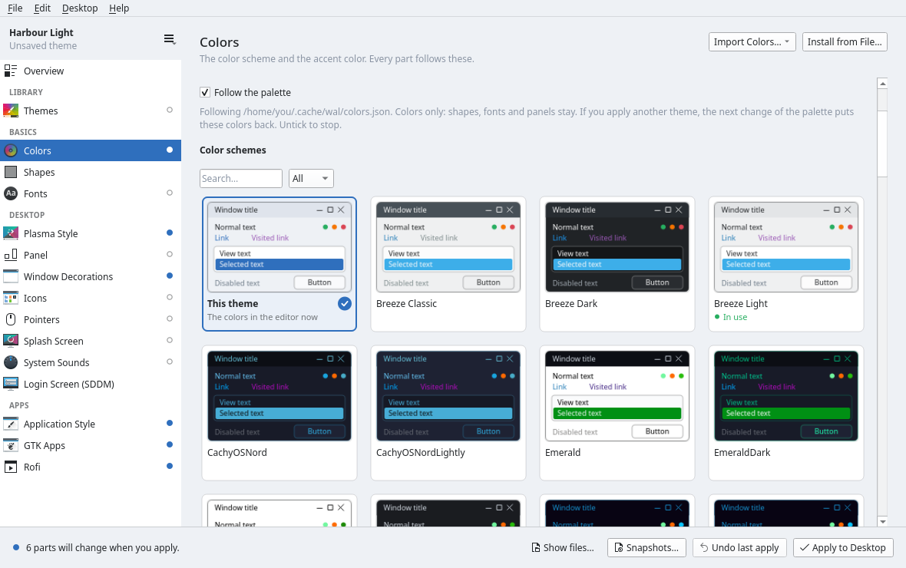

- It is **off** until you tick it. It can only be ticked when a palette file exists or pywal or matugen is installed.
- While it is on, a small background program, started when you log in to Plasma, looks at the palette file every two seconds. When the file has changed and stayed still for a moment, the colors of your theme are made again from it (with the same choices you made in **Import Colors…**) and put on the desktop. The window does not need to be open.
- **Only the colors and the accent** follow. Shapes, fonts, panels and artwork are not touched, and neither is your theme file. The window frame made by this app, the Kvantum style and the GTK sheets are not recolored: apply the theme from the app to bring them up to date.
- Switching on takes **one** snapshot. The automatic changes take none, so your snapshot list does not fill up.
- **Applying another theme** does not stop following: at the next change of the palette the palette's colors are put back over the new theme's colors. Untick the box first if you do not want that.
- **Switching off** by unticking, or by **Undo last apply** while the snapshot of switching on is the newest, puts the desktop back byte for byte and stops the background program. If you applied something else in the meantime, switching off keeps the colors as they are and only stops following; Undo then goes back step by step.

Command line: `plasma-theme-studio follow on FILE`, `follow off`, `follow status`, and `follow --once` to apply the palette once.

## Export, import and sharing

- **File > Export Theme…** packs a theme and its own frame pictures into one file ending in `.ptstheme`. Send that file to anyone.
- **File > Import Theme…** reads such a file and saves the theme in your library. Nothing is applied; it appears under **My themes**.
- **File > Export as Global Theme…** writes a folder that System Settings can use as a Global Theme, with `install.sh` and `uninstall.sh`. It holds the colors, the window frame and the Plasma style only. A Global Theme always turns the splash screen off; the message says so.

A theme file is plain text, so you can also send it, keep it in a Git repository, or edit it by hand. `plasma-theme-studio validate FILE` checks it.

## The command line

The commands below cover the main jobs from a terminal: checking, applying and undoing themes, exporting and importing, and following a palette. Editing a theme is done in the window or in the theme file.

```
plasma-theme-studio [FILE]             open the editor
plasma-theme-studio validate FILE      check a theme file
plasma-theme-studio status FILE        show what an apply would change, part by part
plasma-theme-studio apply FILE         apply a theme file to the desktop
plasma-theme-studio apply FILE --variant light|dark
plasma-theme-studio restore            undo the latest apply (repeat to go further back)
plasma-theme-studio restore --list     list the snapshots
plasma-theme-studio restore ID         go back to a chosen snapshot
plasma-theme-studio export FILE [OUT]  pack a theme as a .ptstheme file
plasma-theme-studio import FILE        save a .ptstheme file or theme file in your library
plasma-theme-studio export-global-theme FILE FOLDER
plasma-theme-studio follow on FILE | off | status | --once
```

`apply` refuses to replace a file that has the name of one of its own but was not made by this app. `apply --replace` overrides that when you mean it.

## Where files are written, and how to get everything back

**Where.** The app writes only inside your home folder and never asks for the administrator's password.

| What | Where |
|---|---|
| Your themes | `~/.local/share/plasma-theme-studio/themes/` |
| Snapshots | `~/.local/share/plasma-theme-studio/snapshots/` |
| Color schemes | `~/.local/share/color-schemes/` |
| Window frames | `~/.local/share/aurorae/themes/` |
| Plasma styles | `~/.local/share/plasma/desktoptheme/` |
| Kvantum themes | `~/.config/Kvantum/` |
| GTK style sheets | `~/.config/gtk-3.0/` and `~/.config/gtk-4.0/` |
| Rofi theme | `~/.config/rofi/` |
| Follow the palette | `~/.config/plasma-theme-studio/follow.json` and `~/.config/autostart/plasma-theme-studio-follow.desktop` |

Besides those, an apply changes settings in KDE's own files (for example `kdeglobals`) the way System Settings does. **Show files…** lists every file and every setting before you apply.

**The safety rules.**

- A **snapshot** is taken before every apply. It holds the files and settings the apply is about to change.
- If an apply fails half way, it is rolled back at once.
- **Undo last apply** puts the files and settings back exactly, also the ones that KDE's own tools changed on their own as a result (for example the GTK color files).
- **Snapshots…** lists them. Going back to an older snapshot also undoes every apply after it, newest first, so nothing is left half in place. A progress bar shows how far it is.
- A part that is left as it is is never touched.
- The app does not replace a file that it did not make.

**If the desktop becomes hard to use**, switch to a text console (Ctrl+Alt+F3), log in and run:

```sh
plasma-theme-studio restore
```

Repeat it to go further back.

## Questions and answers

**A part says "Left as it is". Is something wrong?**
No. It means the theme does not name this part, so the desktop keeps what it has. Choose **Set by this theme** on that page when you want the theme to decide. In the side bar the part shows a small empty ring.

**The Application Style page says "This theme" needs a small helper program. Can I still use the app?**
Yes. Only **Application Style > This theme** needs Kvantum, a small program that draws the look of buttons and fields. Install the package `kvantum` (on Debian and Ubuntu `qt6-style-kvantum`) with your software manager. Everything else works without it.

**Rofi is not installed. Does that matter?**
Only when the theme asks for a Rofi theme. Then the Overview shows Rofi as "Cannot be applied", and the apply says "Rofi was not found" before it writes anything. Choose **Leave as it is** on the Rofi page and everything else applies. All the other pages work without Rofi.

**Why can I not edit the login screen?**
It belongs to the whole computer, and changing it needs an administrator's password. The app opens the right page of System Settings for you.

**Do I need Inkscape, pywal or matugen?**
No. They are only needed for drawing your own frames (Inkscape) and for importing or following their palettes.

**Is the window frame, panel or the colors different from my theme after a while?**
A window frame made by this app has its colors drawn into it. If you change the color scheme in System Settings, apply the theme again from the app. A color scheme you switch to in the app updates the frame by itself.

**Apply to Desktop is grayed out.**
The bar says why. Usually the theme would change nothing (every part is already so). Either something is blocked and the bar names the part, or you have not changed anything yet.

**The panel is thicker than I set.**
Plasma makes a panel at least twice as thick as its corner radius, and it does not shrink it back by itself. Set the thickness on **Panel** to get it back.

**How do I take back one thing, not everything?**
**Undo last apply** takes back the latest apply. If that apply changed many parts, choose **Leave as it is** for the parts you did not want and apply again.

**How do I remove everything the app wrote?**
1. If you used Follow the palette, switch it off first: untick it on **Colors** or run `plasma-theme-studio follow off`.
2. Choose **Snapshots…** and go back to the oldest one, or run `plasma-theme-studio restore` until it says there is nothing left. The desktop is as it was before you started.
3. Delete the folder `~/.local/share/plasma-theme-studio/` (your themes and snapshots) if you do not want to keep them.

Files that the app made and that stay after step 2 are only your own saved themes.

**Where do I report a problem or ask for a new feature?**
At the project page on GitHub: https://github.com/Kryckan/plasma-theme-studio. What works and what does not is in [STATUS.md](STATUS.md).
